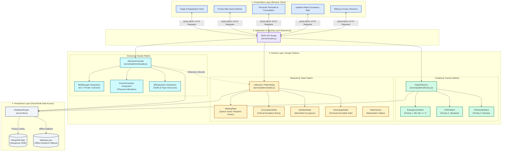
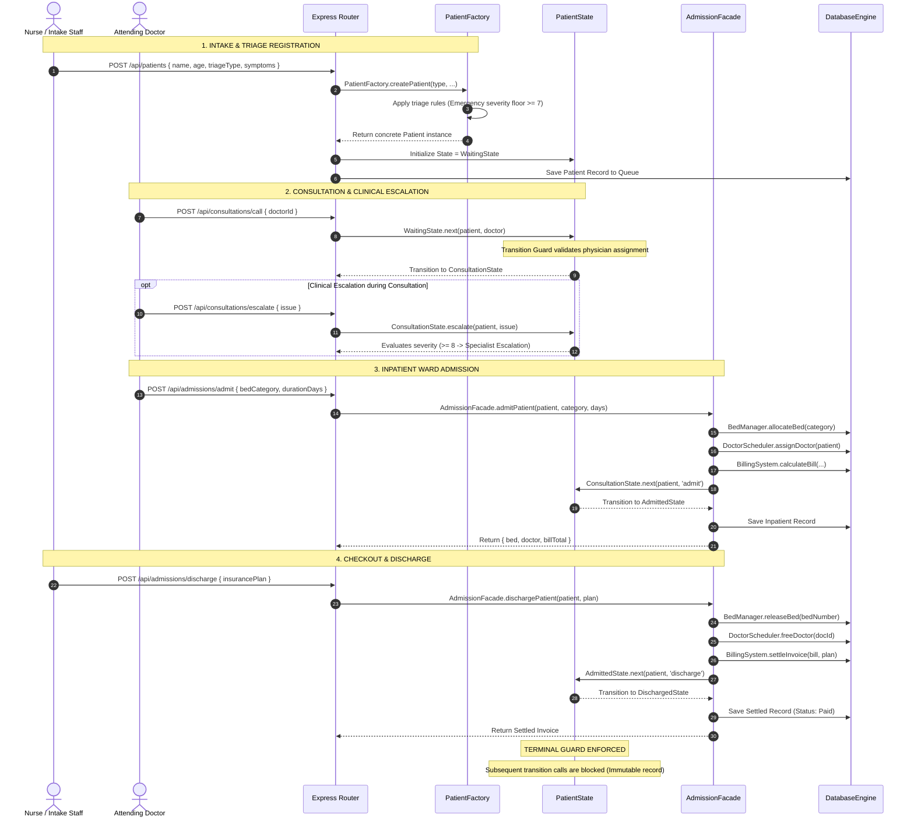

# 🏥 BioCare EHR - Hospital Queue & Clinical Workflow Management System

[](https://developer.mozilla.org/en-US/docs/Web/JavaScript)
[](https://nodejs.org/)
[](https://expressjs.com/)
[](https://www.mongodb.com/)
[](https://opensource.org/licenses/MIT)

**BioCare EHR** is a full-stack, enterprise-grade hospital queue management and triage application. Designed to model real-world clinical healthcare workflows, the platform automates emergency triage evaluation, priority patient queuing, physician consultations, inpatient ward bed assignments, and billing invoice checkout.

The system is engineered around **Three Core Gang of Four (GoF) Design Patterns**:
* 🏗️ **Creational**: **Factory Method Pattern** (`PatientFactory`)
* 🏛️ **Structural**: **Facade Pattern** (`AdmissionFacade`)
* 🔄 **Behavioral**: **State Pattern** (`PatientState`)

---

## 🏛️ System Architecture

BioCare EHR employs a decoupled **Three-Tier Architecture**:
* **Presentation Tier**: Responsive HTML5, CSS3, and JavaScript front-end featuring a dynamic triage intake desk, live priority queue monitor, physician call terminals, ward occupancy map, and billing ledger.
* **Domain & Application Tier**: Express.js REST API with domain modules governed by the Factory Method, Facade, and State patterns.
* **Persistence Tier**: Dual-mode data access engine supporting primary cloud storage via MongoDB Atlas and a local, resilient JSON data store (`database.json`) for seamless offline operation.



---

## 🗺️ Clinical Workflow & Pattern Sequence



---

## 🔍 Core Design Patterns

### 1. 🏗️ Factory Method Pattern (Creational)
* **Location**: `server/patterns/factory.js`
* **Purpose**: Encapsulates patient object instantiation and enforces triage-specific baseline rules.
* **Classes**:
  * `EmergencyPatient`: Priority score `1` (Urgent), severity score auto-floored to $\ge 7$.
  * `OPDPatient`: Priority score `2` (Medium), standard outpatient flow.
  * `FollowUpPatient`: Priority score `3` (Routine), minimal base tariff.
* **Key Capabilities**:
  * `PatientFactory.createPatient()`: Instantiates domain subclasses dynamically based on triage input.
  * `PatientFactory.reconstitute()`: Reconstructs domain class instances with methods intact from stored JSON/MongoDB records.
* **Benefit**: Removes object creation branching from route controllers and satisfies the Open/Closed Principle for new patient categories.

---

### 2. 🏛️ Facade Pattern (Structural)
* **Location**: `server/patterns/facade.js`
* **Purpose**: Exposes unified, high-level operations for complex multi-subsystem hospital workflows.
* **Subsystems Coordinated**:
  * `BedManager`: Allocates and releases beds across ICU (`$2000/day`), Private Rooms (`$1200/day`), and General Wards (`$500/day`).
  * `DoctorScheduler`: Manages physician availability, assignment, and release.
  * `BillingSystem`: Compiles itemized invoices and applies payer policies (Standard, Government Insured, Premium Private, Corporate).
* **Unified Operations**:
  * `admitPatient(patient, bedCategory, durationDays)`: Reserves bed, assigns supervising doctor, calculates billing, updates patient record, and executes the `AdmittedState` transition.
  * `dischargePatient(patient, insurancePlan)`: Releases bed, frees doctor, settles invoice with insurance subsidies, marks bill as Paid, and executes the `DischargedState` transition.
* **Benefit**: Eliminates brittle multi-step coordination across route handlers and ensures transactional integrity.

---

### 3. 🔄 State Pattern (Behavioral)
* **Location**: `server/patterns/state.js`
* **Purpose**: Governs patient lifecycle progression and encapsulates state-specific behaviors and transition guards.
* **State Lifecycle**:
  $$\text{WaitingState} \xrightarrow[\text{Assign Doctor}]{\text{next()}} \text{ConsultationState} \xrightarrow[\text{Admit directive}]{\text{next()}} \text{AdmittedState} \xrightarrow[\text{Settle checkout}]{\text{next()}} \text{DischargedState}$$
* **Classes**:
  * `PatientState` (Abstract Base): Defines lifecycle interface (`getStateName()`, `next()`, `escalate()`) with default transition guards that throw descriptive domain errors.
  * `WaitingState`: Enforces doctor assignment guard before allowing consultation. Blocks premature admission or discharge.
  * `ConsultationState`: Evaluates vital signs and clinical severity scores. Routes severe cases ($\ge 8$) to senior specialists with ICU priority.
  * `AdmittedState`: Manages inpatient ward occupancy. Requires checkout settlement to advance.
  * `DischargedState`: Terminal state. Strictly blocks any subsequent state changes or clinical escalations, protecting finalized records.
  * `StateFactory`: Utility factory for rehydrating state instances from persisted string identifiers.
* **Benefit**: Eliminates scattered string comparisons and conditional flags, ensuring that clinical workflows cannot violate operational sequencing.

---

## 📊 State Transition & Guard Matrix

| Current State | Action / Input | Transition Guard / Precondition | Next State | Clinical Outcome |
| :--- | :--- | :--- | :--- | :--- |
| **WaitingState** | `next(patient, doctor)` | `doctor` must be valid assigned physician object | `ConsultationState` | Doctor begins clinical examination |
| **WaitingState** | `next(patient, 'admit')` | Illegal transition from waiting | *Throws Error* | Blocked: Patient must undergo consultation first |
| **ConsultationState** | `escalate(patient, issue)` | Evaluates `severityScore` & symptoms | *Retains State* | $\ge 8$: Escalated to Specialist with ICU priority |
| **ConsultationState** | `next(patient, 'admit')` | Doctor signs admission directive | `AdmittedState` | Bed allocated, supervising doctor assigned |
| **ConsultationState** | `next(patient, 'discharge')` | Doctor signs outpatient release | `DischargedState` | Outpatient discharged home directly with prescriptions |
| **AdmittedState** | `next(patient, 'discharge')` | Requires checkout settlement | `DischargedState` | Bed released, doctor freed, invoice marked Paid |
| **AdmittedState** | `escalate(patient, issue)` | Triage escalation on ward occupants | *Throws Error* | Blocked: Ward occupants cannot undergo triage queue escalation |
| **DischargedState** | *Any call to next() or escalate()* | Terminal state immutability | *Throws Error* | Blocked: Case closed; records are immutable |

---

## 🌐 REST API Reference

| Method | Endpoint | Description | Handled By |
| :--- | :--- | :--- | :--- |
| `GET` | `/api/patients` | Retrieve active queue, history, doctors, and bed status | Database Engine |
| `POST` | `/api/patients` | Register a new patient through triage intake | **Factory Method** (`PatientFactory.createPatient`) |
| `POST` | `/api/consultations/call` | Assign doctor and call next waiting patient | **State Pattern** (`WaitingState.next`) |
| `POST` | `/api/consultations/escalate` | Escalate patient condition during consultation | **State Pattern** (`ConsultationState.escalate`) |
| `POST` | `/api/consultations/discharge`| Discharge an outpatient directly after consultation | **State Pattern** (`ConsultationState.next`) |
| `POST` | `/api/admissions/admit` | Admit patient to an inpatient ward | **Facade** (`admitPatient`) & **State** (`AdmittedState`) |
| `POST` | `/api/admissions/discharge`| Settle invoice and discharge inpatient | **Facade** (`dischargePatient`) & **State** (`DischargedState`) |
| `POST` | `/api/reset` | Reset all patients, beds, and doctors to initial state | System Utility |

---

## 🧪 Automated Testing

The project includes an automated test harness covering all three design patterns:

```bash
npm test
```

### Verified Test Output:
```text
===============================================================
   AUTOMATED VERIFICATION: 3 JUSTIFIABLE DESIGN PATTERNS
===============================================================

[1. Factory Method Pattern Test (Creational)]
  ✅ OPDPatient instantiated with correct category priority (2).
  ✅ EmergencyPatient instantiated with top triage priority (1).
  ✅ FollowUpPatient instantiated with routine priority (3).
  ✅ Factory rule enforced: Emergency patient severity score auto-floored to urgent (>= 7).
  ✅ PatientFactory.reconstitute() restored domain entity with methods intact.

[2. State Pattern Lifecycle Test (Behavioral)]
  ✅ Initial State verified: Waiting.
  ✅ Transition Guard enforced: Cannot enter Consultation without assigning a doctor.
  ✅ Transition 1 verified: WaitingState -> ConsultationState.
  ✅ State Clinical Escalation handled correctly: "Junior Doctor resolved: Prescribed medication and ordered standard tests. Case closed.".
  ✅ Transition 2 verified: ConsultationState -> AdmittedState.
  ✅ Transition 3 verified: AdmittedState -> DischargedState.
  ✅ Terminal Guard enforced: Cannot transition out of terminal DischargedState.

[3. Facade Pattern Subsystem Orchestration Test (Structural)]
  ✅ Facade admitPatient() coordinated all subsystems:
     - BedManager Subsystem: Allocated Bed ICU-101 (ICU)
     - DoctorScheduler Subsystem: Assigned Dr. Sarah Connor
     - BillingSystem Subsystem: Base $250 + Bed $8000 = Total $8360
     - State Subsystem: Transitioned to AdmittedState
  ✅ Facade dischargePatient() coordinated checkout & release:
     - BedManager Subsystem: Released bed allocation
     - DoctorScheduler Subsystem: Freed supervising doctor
     - BillingSystem Subsystem: Settled invoice ($2727) marked as Paid
     - State Subsystem: Transitioned to terminal DischargedState

===============================================================
 🎉 ALL 3 JUSTIFIABLE DESIGN PATTERN TESTS PASSED SUCCESSFULLY!
===============================================================
```

---

## 🚀 Getting Started

### 📋 Prerequisites
* **Node.js** (v16.x or higher)
* **npm** (v8.x or higher)

### ⚙️ Installation & Running
```bash
# 1. Clone the repository
git clone https://github.com/divitha2005-hub/Hospital-Queue.git
cd Hospital_Queue

# 2. Install dependencies
npm install

# 3. Configure environment (Optional - default runs in resilient offline JSON mode)
cp .env.example .env

# 4. Start the server
npm start
```

Navigate to **[http://localhost:8000](http://localhost:8000)** in your browser to access the EHR application.

---

## 📄 License
This project is licensed under the [MIT License](LICENSE).
