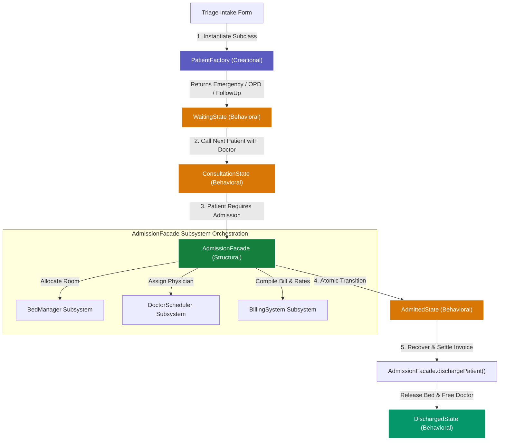

# 🏥 BioCare EHR - Design-Pattern Driven Enterprise Healthcare System

[](https://developer.mozilla.org/en-US/docs/Web/JavaScript)
[](https://nodejs.org/)
[](https://expressjs.com/)
[](https://www.mongodb.com/)
[](https://opensource.org/licenses/MIT)

**BioCare EHR** is a high-fidelity, interactive clinical workspace and hospital queue simulator. Architected with strict adherence to clean software design principles, it implements **3 Core Gang of Four (GoF) Design Patterns**—one from each classic architectural classification:

* 🏗️ **Creational**: **Factory Method Pattern** (`PatientFactory`)
* 🏛️ **Structural**: **Facade Pattern** (`AdmissionFacade`)
* 🔄 **Behavioral**: **State Pattern** (`PatientState`)

---

## 🗺️ Architectural Workflow Map

This diagram illustrates how patient data flows through the 3 justifiable design patterns across the entire patient journey:



---

## 🏛️ Comprehensive Justification of the 3 Patterns

### 1. 🏗️ Factory Method Pattern (Creational)
* **Source Location**: [server/patterns/factory.js](file:///c:/Users/saisa/Documents/Hospital_Queue/server/patterns/factory.js) & [public/js/patterns/factory.js](file:///c:/Users/saisa/Documents/Hospital_Queue/public/js/patterns/factory.js)
* **Role in System**: Patient Intake, Triage Classification, and Polymorphic Initialization.
* **Why this Pattern is Justified**:
  * **Clinical Justification**: A hospital intake desk does not treat all arriving individuals identically. Patients belong to distinct clinical profiles:
    * `EmergencyPatient`: Life-threatening or urgent situations (priority score 1, initial severity auto-floored $\ge 7$, highest base tariffs).
    * `OPDPatient`: General outpatient clinics (priority score 2, standard consultation).
    * `FollowUpPatient`: Routine post-procedure reviews (priority score 3, minimal base fees).
  * **Software Engineering Justification (Open/Closed Principle)**: Without the Factory Method, routing and controller code becomes littered with bloated `switch/if-else` conditionals whenever patient properties or behaviors vary. The Factory decouples client code from concrete subclass constructors. When adding new medical categories (e.g., `PediatricPatient`, `TelehealthPatient`), developers simply introduce a new subclass without altering triage intake controllers.
  * **Reconstitution Capability**: Encapsulates `reconstitute()` to deserialize raw JSON database records back into fully functional, method-rich domain class instances.

---

### 2. 🏛️ Facade Pattern (Structural)
* **Source Location**: [server/patterns/facade.js](file:///c:/Users/saisa/Documents/Hospital_Queue/server/patterns/facade.js) & [public/js/patterns/facade.js](file:///c:/Users/saisa/Documents/Hospital_Queue/public/js/patterns/facade.js)
* **Role in System**: Inpatient Admission, Ward Coordination, and Billing Settlement.
* **Why this Pattern is Justified**:
  * **Clinical Justification**: In a real hospital, admitting or checking out a patient is never a single simple database update. It requires simultaneous coordination across multiple hospital departments:
    1. **Bed Allocation**: Checking inventory across ICU, Private Rooms, and General Wards.
    2. **Physician Scheduling**: Matching available supervising doctors to the ward occupant.
    3. **Billing & Accounting**: Compiling accommodation charges, pharmacy expenditures, and applying insurance tariff deductions.
  * **Software Engineering Justification (Subsystem Decoupling & High Cohesion)**: Exposing individual subsystem APIs (`BedManager`, `DoctorScheduler`, `BillingSystem`) directly to web routing layers tightly couples the HTTP controllers to internal database models. `AdmissionFacade` acts as a unified, structural wrapper providing clean atomic operations (`admitPatient()`, `dischargePatient()`), ensuring that bed reservation, doctor assignment, invoice calculation, and state transition succeed or fail as a single coherent unit.

---

### 3. 🔄 State Pattern (Behavioral)
* **Source Location**: [server/patterns/state.js](file:///c:/Users/saisa/Documents/Hospital_Queue/server/patterns/state.js) & [public/js/patterns/state.js](file:///c:/Users/saisa/Documents/Hospital_Queue/public/js/patterns/state.js)
* **Role in System**: Patient Clinical Lifecycle and Transition Governance.
* **Why this Pattern is Justified**:
  * **Clinical Justification**: Healthcare governance and legal protocols mandate strict adherence to patient progression:
    $$\text{Waiting} \longrightarrow \text{Consultation} \longrightarrow \text{Admitted} \longrightarrow \text{Discharged}$$
    * A patient **cannot** be admitted directly from the waiting lobby without physician examination.
    * A patient **cannot** be discharged without doctor consultation or settlement of inpatient invoices.
    * A patient in the terminal `Discharged` state cannot undergo new triage transitions without registering a new clinical encounter.
  * **Software Engineering Justification (Single Responsibility & Guard Integrity)**: Eliminates fragile conditional status flag checking (`if (status === 'waiting' && hasDoctor)`) scattered throughout endpoints. Each stage is an autonomous class (`WaitingState`, `ConsultationState`, `AdmittedState`, `DischargedState`) inheriting from `PatientState`. Each class encapsulates its own valid transition guards and error handling, making invalid state bypasses impossible at the model layer.

---

## ⚖️ Why Keep These 3 Patterns Over 7 Patterns?

| Criterion | Original 7 Patterns | Streamlined 3 Justifiable Patterns |
| :--- | :--- | :--- |
| **Architectural Balance** | 2 Creational, 1 Structural, 4 Behavioral | **1 Creational, 1 Structural, 1 Behavioral** (GoF Trifecta) |
| **Separation of Concerns** | Over-engineered (modules acting as patterns) | **Clean Mapping**: Intake (Factory) ➔ Coordination (Facade) ➔ Lifecycle (State) |
| **Maintainability** | High coupling and redundant layers | Decoupled architecture focused strictly on core domain concerns |
| **Defensibility in Reviews** | Complex to defend arbitrary patterns | **Water-tight, clinical & software engineering justifications** |

---

## 🚀 Getting Started

### 📋 Prerequisites
* Node.js (v16.x or higher)
* NPM (v8.x or higher)

### 🔧 Installation & Running
1. Clone the repository:
   ```bash
   git clone https://github.com/divitha2005-hub/Hospital-Queue.git
   cd Hospital_Queue
   ```
2. Install dependencies:
   ```bash
   npm install
   ```
3. Launch the application:
   ```bash
   npm start
   ```
4. Open your browser and navigate to:
   🔗 **[http://localhost:8000](http://localhost:8000)**

---

## 🧪 Automated Testing

Execute the design pattern test harness to verify class behaviors, factory creation, state guards, and facade transactions:
```bash
npm test
```
*(All 3 pattern test suites will execute and output detailed assertions to the terminal, falling back to local JSON database mode if MongoDB Atlas is offline).*
