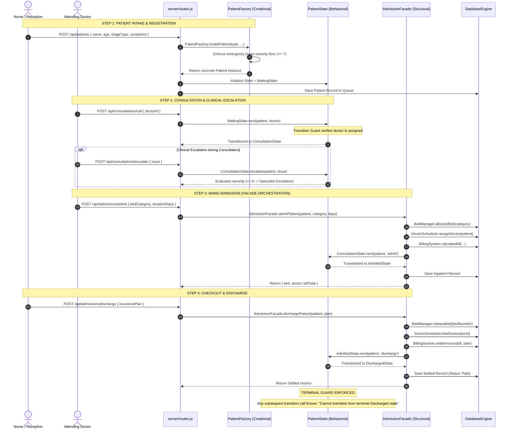

# 🏥 BioCare EHR - Design-Pattern Driven Enterprise Healthcare System

[](https://developer.mozilla.org/en-US/docs/Web/JavaScript)
[](https://nodejs.org/)
[](https://expressjs.com/)
[](https://www.mongodb.com/)
[](https://vit.ac.in)
[](https://opensource.org/licenses/MIT)

**BioCare EHR** is a full-stack, design-pattern-driven hospital queue management and triage system developed for the **ISWE404L - Design Patterns** course at **Vellore Institute of Technology (VIT)**.

The architecture is strictly centered around **3 Justifiable Gang of Four (GoF) Design Patterns**—one from each foundational classification:
1. 🏗️ **Creational**: **Factory Method Pattern** (`PatientFactory`)
2. 🏛️ **Structural**: **Facade Pattern** (`AdmissionFacade`)
3. 🔄 **Behavioral**: **State Pattern** (`PatientState`)

All extraneous patterns (Strategy, Chain of Responsibility, Singleton, Observer) were purposefully eliminated to maximize cohesion, reduce cognitive bloat, and maintain strict adherence to SOLID principles.

---

## 👥 Project Team & Academic Credentials

* **Course**: `ISWE404L - Design Patterns - TH`
* **Institution**: School of Information Technology and Engineering (SITE), **VIT Vellore**
* **Faculty Guide**: **Dr. SENTHIL KUMAR. U**
* **Project Contributors**:
  * **C. Safalya** (Reg: `23MIS0125`)
  * **G. Sai Santhosh** (Reg: `23MIS0227`)
  * **CP. Jyotheswar** (Reg: `23MIS0097`)
* **Project Documentation**: [BioCare_Design_Patterns_Final_Report.docx](BioCare_Design_Patterns_Final_Report.docx)

---

## 🏛️ System Architecture

BioCare EHR follows a **Three-Tier Enterprise Architecture**:
* **Presentation Tier**: Responsive HTML5, CSS3, and modern vanilla JavaScript with interactive triage forms, live wait queue, doctor terminals, ward bed map, and billing invoice screens.
* **Domain & Application Tier**: Express.js REST API with business modules decoupled through the 3 core design patterns.
* **Persistence Tier**: Dual-mode storage featuring MongoDB Atlas with automated fallback to a resilient local `database.json` store for offline operations.

```mermaid
flowchart TD
    subgraph PresentationTier ["1. Presentation Layer (Browser Client)"]
        UI1["Triage & Registration Desk\n(public/index.html)"]
        UI2["Priority Wait Queue\n(Live Triage Display)"]
        UI3["Physician Terminals\n(Consultation Desk)"]
        UI4["Inpatient Ward Map\n(ICU, Private, General)"]
        UI5["Billing & Checkout\n(Invoice Settlement)"]
    end

    subgraph APITier ["2. Application & API Routing Layer (Express.js)"]
        Routes["REST API Router\n(server/routes.js)"]
    end

    subgraph PatternTier ["3. Domain Layer: 3 Justifiable Design Patterns"]
        subgraph CreationalPattern ["Creational: Factory Method"]
            PF["PatientFactory\n(server/patterns/factory.js)"]
            P1["EmergencyPatient\n(Priority 1, Floor Sev >= 7)"]
            P2["OPDPatient\n(Priority 2, Standard)"]
            P3["FollowUpPatient\n(Priority 3, Routine)"]
            PF --> P1
            PF --> P2
            PF --> P3
        end

        subgraph BehavioralPattern ["Behavioral: State Pattern"]
            PS["«Abstract» PatientState\n(server/patterns/state.js)"]
            S1["WaitingState\n(Queue Guard: Requires Doctor)"]
            S2["ConsultationState\n(Clinical Escalation Rules)"]
            S3["AdmittedState\n(Ward Bed Occupancy)"]
            S4["DischargedState\n(Terminal Immutable Sink)"]
            SF["StateFactory\n(Rehydration Helper)"]
            PS --> S1
            PS --> S2
            PS --> S3
            PS --> S4
        end

        subgraph StructuralPattern ["Structural: Facade Pattern"]
            AF["AdmissionFacade\n(server/patterns/facade.js)"]
            BM["BedManager Subsystem\n(ICU / Private / General)"]
            DS["DoctorScheduler Subsystem\n(Physician Allocation)"]
            BS["BillingSystem Subsystem\n(Tariffs & Payer Discounts)"]
            AF --> BM
            AF --> DS
            AF --> BS
        end
    end

    subgraph DataTier ["4. Persistence Layer (Dual-Mode Data Access)"]
        DB["DatabaseEngine (server/db.js)"]
        Mongo[("MongoDB Atlas\n(Mongoose ORM)")]
        LocalJSON[("database.json\n(Offline Resilient Fallback)")]
        DB -->|Primary Online| Mongo
        DB -->|Offline Fallback| LocalJSON
    end

    UI1 & UI2 & UI3 & UI4 & UI5 <-->|JSON REST HTTP Requests| Routes
    Routes --> PF
    Routes --> AF
    Routes --> PS
    AF -.->|Advances Lifecycle| PS
    PF --> DB
    AF --> DB
    PS --> DB

    classDef client fill:#dbeafe,stroke:#1d4ed8,stroke-width:2px;
    classDef router fill:#ede9fe,stroke:#6d28d9,stroke-width:2px;
    classDef factory fill:#d1fae5,stroke:#047857,stroke-width:2px;
    classDef state fill:#fef3c7,stroke:#b45309,stroke-width:2px;
    classDef facade fill:#cffafe,stroke:#0e7490,stroke-width:2px;
    classDef db fill:#f1f5f9,stroke:#475569,stroke-width:2px;

    class UI1,UI2,UI3,UI4,UI5 client;
    class Routes router;
    class PF,P1,P2,P3 factory;
    class PS,S1,S2,S3,S4,SF state;
    class AF,BM,DS,BS facade;
    class DB,Mongo,LocalJSON db;
```



---

## 🗺️ Patient Journey & Design Pattern Interaction

This sequence diagram illustrates how all three patterns collaborate across one complete clinical encounter:



---

## 🔍 The 3 Justifiable Design Patterns in Detail

### 1. 🏗️ Factory Method Pattern (Creational)
* **Implementation**: [`server/patterns/factory.js`](server/patterns/factory.js)
* **Intent**: Define an interface for creating objects, letting subclasses decide which class to instantiate.
* **Role in System**: Converts raw intake form payloads into specialized domain objects:
  * `EmergencyPatient`: Highest triage queue priority (`1`), enforces severity auto-flooring (`severityScore >= 7`), highest baseline consultation tariff.
  * `OPDPatient`: General outpatient priority (`2`), standard severity scores.
  * `FollowUpPatient`: Routine follow-up priority (`3`), minimal triage base fee.
* **Key Methods**:
  * `PatientFactory.createPatient(id, name, age, type, severity, symptoms)`: Instantiates domain subclass and applies clinical baseline rules.
  * `PatientFactory.reconstitute(storedData)`: Rehydrates plain JSON database records back into fully functional class entities with domain methods.
* **Why Justified**:
  * **Decoupling**: API controllers are shielded from concrete constructors (`new EmergencyPatient`).
  * **Open/Closed Principle**: New patient classifications (e.g., `PediatricPatient`, `OncologyPatient`) can be added by introducing a new subclass without modifying existing route handlers.

---

### 2. 🏛️ Facade Pattern (Structural)
* **Implementation**: [`server/patterns/facade.js`](server/patterns/facade.js)
* **Intent**: Provide a unified, simplified interface to a complex subsystem.
* **Role in System**: Coordinates three interdependent clinical subsystems behind clean high-level operations:
  * `BedManager`: Manages occupancy across ICU (`$2000/day`), Private Rooms (`$1200/day`), and General Wards (`$500/day`).
  * `DoctorScheduler`: Manages physician availability, assignment, and release.
  * `BillingSystem`: Compiles itemized invoices (base fee + bed charge + medication charges) and handles payer policies (`govt`, `premium`, `corporate`).
* **Unified Operations**:
  * `admitPatient(patient, bedCategory, durationDays)`: Reserves bed, assigns doctor, calculates initial bill, advances state to `AdmittedState`, and persists the record.
  * `dischargePatient(patient, insurancePlan)`: Releases bed, frees doctor, settles final invoice with insurance subsidies, advances state to `DischargedState`, and marks bill as `Paid`.
* **Why Justified**:
  * Eliminates complex multi-step orchestration in HTTP controllers.
  * Guarantees transactional consistency across bed inventory, doctor schedules, and billing statements.

---

### 3. 🔄 State Pattern (Behavioral)
* **Implementation**: [`server/patterns/state.js`](server/patterns/state.js)
* **Intent**: Allow an object to alter its behavior when its internal state changes, appearing as if it changed its class.
* **Role in System**: Governs the patient lifecycle progression:
  $$\text{WaitingState} \xrightarrow[\text{Assign Doctor}]{\text{next()}} \text{ConsultationState} \xrightarrow[\text{Admit directive}]{\text{next()}} \text{AdmittedState} \xrightarrow[\text{Settle checkout}]{\text{next()}} \text{DischargedState}$$
* **Classes**:
  * `PatientState` (Abstract Base): Declares `getStateName()`, `next(patient, option)`, and `escalate(patient, issue)`. Throws descriptive domain errors on illegal transitions.
  * `WaitingState`: Initial queue state. Transition guard requires an assigned physician object before advancing to consultation. Blocks admission or discharge.
  * `ConsultationState`: Active clinical evaluation state. Implements automated clinical escalation based on vitals and severity scores. Resolves into inpatient admission or direct discharge.
  * `AdmittedState`: Inpatient state. Manages active bed occupancy. Only permits transition to `DischargedState` via checkout.
  * `DischargedState`: Terminal state. Strictly blocks any subsequent transitions or escalations, guaranteeing post-discharge data immutability.
  * `StateFactory`: Utility factory restoring concrete state instances during database rehydration.
* **Why Justified**:
  * Replaces fragile status string comparisons and nested `if-else` chains with encapsulated state classes.
  * Prevents dangerous medical workflows (e.g., discharging a patient before consultation, admitting an already discharged patient).

---

## 📊 State Transition & Guard Matrix

| Current State | Action / Input | Transition Guard / Precondition | Next State | Clinical Outcome |
| :--- | :--- | :--- | :--- | :--- |
| **WaitingState** | `next(patient, doctor)` | `doctor` must be valid assigned physician object | `ConsultationState` | Doctor begins clinical examination |
| **WaitingState** | `next(patient, 'admit')` | Illegal transition from waiting | *Throws Error* | Blocked: Patient must undergo consultation first |
| **ConsultationState** | `escalate(patient, issue)` | Evaluates `severityScore` & symptoms | *Retains State* | $\ge 8$: Escalated to Specialist with ICU priority |
| **ConsultationState** | `next(patient, 'admit')` | Doctor signs admission directive | `AdmittedState` | Bed allocated, supervising doctor assigned |
| **ConsultationState** | `next(patient, 'discharge')` | Doctor signs outpatient release | `DischargedState` | Outpatient discharged home directly with prescriptions |
| **AdmittedState** | `next(patient, 'discharge')` | Requires checkout settlement | `DischargedState` | Bed released, doctor freed, invoice marked Paid |
| **AdmittedState** | `escalate(patient, issue)` | Triage escalation on ward occupants | *Throws Error* | Blocked: Ward occupants cannot undergo triage queue escalation |
| **DischargedState** | *Any call to next() or escalate()* | Terminal state immutability | *Throws Error* | Blocked: Case closed; records are immutable |

---

## 🌐 REST API Endpoints & Pattern Mapping

| Method | Endpoint | Description | Design Pattern Used |
| :--- | :--- | :--- | :--- |
| `GET` | `/api/patients` | Retrieve queue, admitted patients, doctors, and beds | Domain Engine |
| `POST` | `/api/patients` | Register new patient from triage form | **Factory Method** (`PatientFactory.createPatient`) |
| `POST` | `/api/consultations/call` | Doctor calls next waiting patient | **State Pattern** (`WaitingState.next`) |
| `POST` | `/api/consultations/escalate` | Clinical case escalation | **State Pattern** (`ConsultationState.escalate`) |
| `POST` | `/api/consultations/discharge`| Outpatient direct discharge | **State Pattern** (`ConsultationState.next`) |
| `POST` | `/api/admissions/admit` | Inpatient admission to ward | **Facade** (`admitPatient`) & **State** (`AdmittedState`) |
| `POST` | `/api/admissions/discharge`| Patient checkout and billing | **Facade** (`dischargePatient`) & **State** (`DischargedState`) |
| `POST` | `/api/reset` | Reset all patients, beds, and doctors | Database Utility |

---

## 🧪 Automated Test Suite (`npm test`)

The project includes a comprehensive automated test harness in [`js/test.js`](js/test.js). Execute tests with:

```bash
npm test
```

### Verified Test Output:
```text
===============================================================
   AUTOMATED VERIFICATION: 3 JUSTIFIABLE DESIGN PATTERNS
===============================================================

[1. Factory Method Pattern Test (Creational)]
  ✅ OPDPatient instantiated with correct category priority (2).
  ✅ EmergencyPatient instantiated with top triage priority (1).
  ✅ FollowUpPatient instantiated with routine priority (3).
  ✅ Factory rule enforced: Emergency patient severity score auto-floored to urgent (>= 7).
  ✅ PatientFactory.reconstitute() restored domain entity with methods intact.

[2. State Pattern Lifecycle Test (Behavioral)]
  ✅ Initial State verified: Waiting.
  ✅ Transition Guard enforced: Cannot enter Consultation without assigning a doctor.
  ✅ Transition 1 verified: WaitingState -> ConsultationState.
  ✅ State Clinical Escalation handled correctly: "Junior Doctor resolved: Prescribed medication and ordered standard tests. Case closed.".
  ✅ Transition 2 verified: ConsultationState -> AdmittedState.
  ✅ Transition 3 verified: AdmittedState -> DischargedState.
  ✅ Terminal Guard enforced: Cannot transition out of terminal DischargedState.

[3. Facade Pattern Subsystem Orchestration Test (Structural)]
  ✅ Facade admitPatient() coordinated all subsystems:
     - BedManager Subsystem: Allocated Bed ICU-101 (ICU)
     - DoctorScheduler Subsystem: Assigned Dr. Sarah Connor
     - BillingSystem Subsystem: Base $250 + Bed $8000 = Total $8360
     - State Subsystem: Transitioned to AdmittedState
  ✅ Facade dischargePatient() coordinated checkout & release:
     - BedManager Subsystem: Released bed allocation
     - DoctorScheduler Subsystem: Freed supervising doctor
     - BillingSystem Subsystem: Settled invoice ($2727) marked as Paid
     - State Subsystem: Transitioned to terminal DischargedState

===============================================================
 🎉 ALL 3 JUSTIFIABLE DESIGN PATTERN TESTS PASSED SUCCESSFULLY!
===============================================================
```

---

## 🚀 Quick Start Guide

### 📋 Prerequisites
* **Node.js** (v16.x or higher)
* **npm** (v8.x or higher)

### ⚙️ Installation & Execution
```bash
# 1. Clone repository
git clone https://github.com/divitha2005-hub/Hospital-Queue.git
cd Hospital_Queue

# 2. Install dependencies
npm install

# 3. (Optional) Configure MongoDB Atlas in .env (or run in offline JSON mode automatically)
cp .env.example .env

# 4. Start the server
npm start
```

Open your browser at **[http://localhost:8000](http://localhost:8000)** to interact with the EHR workspace.

---

## 📄 Academic Final Report
The complete 38-page academic report with all 32 diagrams, before/after class structures, source code listings, and verification records is available at:
* [`BioCare_Design_Patterns_Final_Report.docx`](BioCare_Design_Patterns_Final_Report.docx)
