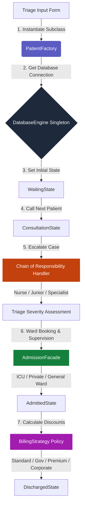

# 🏥 BioCare EHR - Design-Pattern Driven Enterprise Healthcare System

[](https://developer.mozilla.org/en-US/docs/Web/JavaScript)
[](https://nodejs.org/)
[](https://expressjs.com/)
[](https://www.mongodb.com/)
[](https://opensource.org/licenses/MIT)

**BioCare EHR** is a high-fidelity, interactive clinical workspace and hospital queue simulator. Designed for enterprise-level performance, it showcases **7 Gang of Four (GoF) Design Patterns** in a real-time full-stack Node.js environment, utilizing polymorphic data models, state lifecycle management, and transactional facade abstractions.

---

## 🗺️ Architectural Workflow Map

This diagram illustrates how patient data flows through the 7 design patterns from triage to billing checkout:



---

## 🏛️ Comprehensive Design Pattern Specifications

BioCare EHR is engineered to show how design patterns decouple business logic from framework concerns:

### 1. Singleton Pattern (`DatabaseEngine`)
*   **Source File**: `server/db.js`
*   **Why it matters**: Ensures a single, thread-safe gateway to the database. It prevents resource exhaustion and connection leakage by caching a unique authoritative connection instance.
*   **Developer Highlight**: Includes an **Automatic Offline Fallback** that detects connection timeouts (e.g. Atlas IP Whitelist blocks) and redirects operations to a local `database.json` file on disk, maintaining 100% application uptime.

### 2. Factory Method Pattern (`PatientFactory`)
*   **Source File**: `server/patterns/factory.js`
*   **Why it matters**: Decouples the controller logic from concrete patient classes. It dynamically instantiates distinct clinical categories (`OPDPatient`, `EmergencyPatient`, `FollowUpPatient`) using database discriminators to apply category-specific base rates and initial triage severity limits.

### 3. State Pattern (`PatientState` & Lifecycle Manager)
*   **Source File**: `server/patterns/state.js`
*   **Why it matters**: Protects business rules by encapsulating state transitions. A patient moves through `Waiting` ➔ `Consultation` ➔ `Admitted` ➔ `Discharged`. The State pattern blocks illegal transitions (e.g., admitting a patient directly from waiting, or discharging a patient without completing billing checkout) at the model level.

### 4. Chain of Responsibility Pattern (`EscalationHandler`)
*   **Source File**: `server/patterns/chain.js`
*   **Why it matters**: Avoids coupling a clinical alert requester to a single recipient. Warnings are processed through a chain: **Nurse** ($\le 3$ severity) ➔ **Junior Doctor** ($\le 7$ severity) ➔ **Specialist** ($> 7$ severity). Each level evaluates if it can resolve the case or if it must pass the context to the next supervisor in line.

### 5. Facade Pattern (`AdmissionFacade`)
*   **Source File**: `server/patterns/facade.js`
*   **Why it matters**: Provides a simplified interface to a complex set of subsystems. Instead of the API route directly talking to the `BedManager`, `DoctorScheduler`, and `BillingSystem`, the `AdmissionFacade` coordinates the transactions in a single call, ensuring atomic state operations.

### 6. Strategy Pattern (`BillingStrategy`)
*   **Source File**: `server/patterns/strategy.js`
*   **Why it matters**: Implements the Open/Closed Principle. It encapsulates billing discount calculations into interchangeable strategies:
    *   **Standard Strategy**: Flat rates with zero discounts.
    *   **Government Insured**: $70\%$ discount on ward stay, $30\%$ discount on prescriptions.
    *   **Premium Private Insured**: $50\%$ discount on consultation fees, $40\%$ discount on ward stay.
    *   **Corporate Partner**: Flat $15\%$ discount on the final total.
    Selecting an option on checkout dynamically swaps the calculation algorithm at runtime.

### 7. Observer Pattern (SSE Observer Streams)
*   **Source File**: `server/routes.js` & `public/js/app.js`
*   **Why it matters**: Keeps the UI synchronized with the backend state. The server acts as a Server-Sent Events (SSE) **Subject** publishing update alerts (`queueUpdated`, `patientAdmitted`, etc.) when database states shift. Browser panels behave as **Observers**, updating the UI grid instantly.

---

## 🎨 Premium UI/UX Design System

The frontend is a bespoke Single Page Application (SPA) designed to feel like a high-end medical console:
*   **Glassmorphic Console Cards**: Radial gradients, frosted-glass filters, and subtle borders create visual depth.
*   **Snappy Telemetry Visualizer**: Pulsing status indicators, rotating neon dashed radar rings, and a breathing ECG heart monitor welcome screen.
*   **Live Interactive Design Inspector**: A slide-out sidebar allows users to inspect class definitions, UML structures, and execution metrics in real-time.

---

## 🚀 Getting Started

### 📋 Prerequisites
*   Node.js (v16.x or higher)
*   NPM (v8.x or higher)

### 🔧 Installation & Running
1.  Clone the repository:
    ```bash
    git clone https://github.com/divitha2005-hub/Hospital-Queue.git
    cd hospital_queue_system
    ```
2.  Install dependencies:
    ```bash
    npm install
    ```
3.  Launch the development server:
    ```bash
    npm start
    ```
4.  Open your browser and navigate to:
    🔗 **[http://localhost:8000](http://localhost:8000)**

---

## 🧪 Automated Testing
Run the automated design pattern test harness to verify class behaviors, factory outputs, state transitions, chain escalations, facade actions, and strategy arithmetic:
```bash
node js/test.js
```
*(All 7 design pattern verification blocks will run and output assertions to the terminal, falling back to local JSON structures if MongoDB Atlas is offline).*
